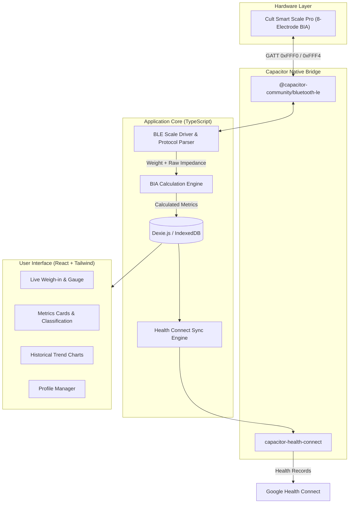
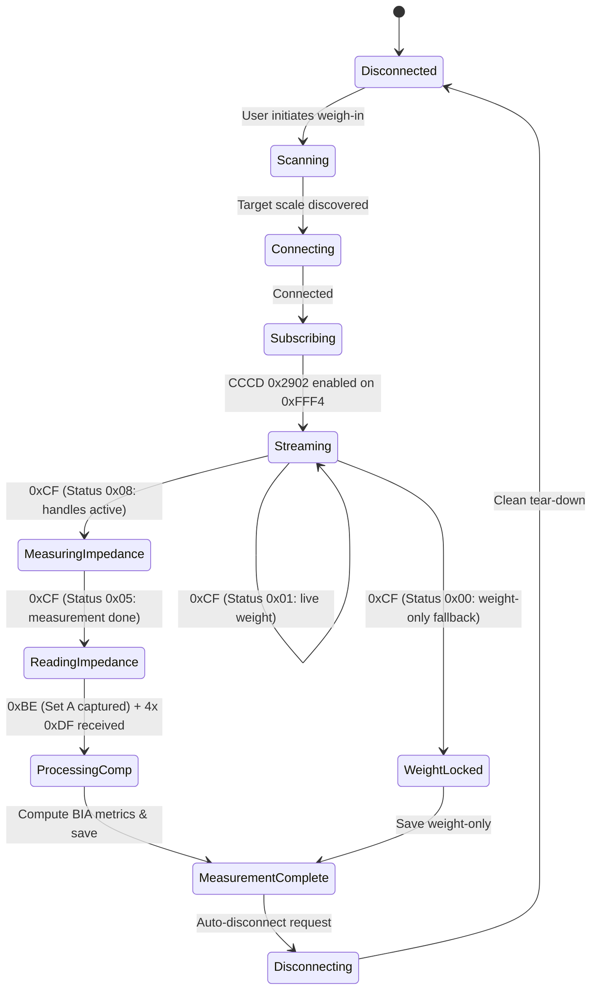
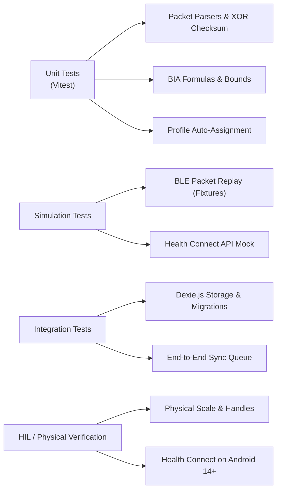

# Kult Konnect — System Design & Architecture

## 1. System Overview

**Kult Konnect** is an offline-first, privacy-focused mobile application built with Capacitor, designed specifically to communicate with the **Cult Smart Scale Pro** via Bluetooth Low Energy (BLE), calculate accurate body composition metrics from raw bioimpedance data, maintain historical trend analytics, and synchronize records to **Google Health Connect**.



---

## 2. Hardware Protocol Specification (Cult Smart Scale Pro)

The Cult Smart Scale Pro communicates via Bluetooth Low Energy (BLE) GATT.

### 2.1 GATT Layout
- **Service UUID**: `0000FFF0-0000-1000-8000-00805F9B34FB` (16-bit: `0xFFF0`)
- **Notify Characteristic UUID**: `0000FFF4-0000-1000-8000-00805F9B34FB` (16-bit: `0xFFF4`)
- **Write Characteristic UUID**: `0000FFF1-0000-1000-8000-00805F9B34FB` (16-bit: `0xFFF1`)
- **CCCD (Client Characteristic Configuration)**: `0x2902`

Subscribing to notifications on `0xFFF4` immediately activates live weight streaming when the scale is awake.

### 2.2 Packet Formats

#### Packet Type 1: Live Weight Stream (`0xCF`, 11 Bytes)
Received continuously while the user is standing on the scale.

| Byte Offset | Type | Description |
| :--- | :--- | :--- |
| `0` | `uint8` | Header: `0xCF` |
| `1` | `uint8` | Flags (e.g., `0x80` = handle contact detected) |
| `2` | `uint8` | Reserved |
| `3..4` | `uint16-LE` | Raw weight. $\text{Weight (kg)} = \frac{\text{data}[4] \ll 8 \mid \text{data}[3]}{100.0}$ |
| `5..8` | `bytes` | Reserved |
| `9` | `uint8` | Status flag: <br>• `0x01`: Live/fluctuating weight reading.<br>• `0x00`: Stable weight locked (no handle contact).<br>• `0x08`: Impedance measurement in progress (handles gripped).<br>• `0x05`: Measurement complete with handles held. |
| `10` | `uint8` | Checksum: XOR of bytes `0..9`. |

#### Packet Type 2: Raw Multi-Frequency Impedance (`0xBE`, 13 Bytes)
Transmitted in 2 consecutive packets (`packetIdx = 0` and `packetIdx = 1`).

| Byte Offset | Type | Description |
| :--- | :--- | :--- |
| `0` | `uint8` | Header: `0xBE` |
| `1` | `uint8` | Packet index: `0x00` (Set A) or `0x01` (Set B) |
| `2..3` | `uint16-LE` | `imp[0]` ($\Omega$) |
| `4..5` | `uint16-LE` | `imp[1]` ($\Omega$) |
| `6..7` | `uint16-LE` | `imp[2]` ($\Omega$) $\rightarrow$ **Whole-body impedance ($\approx 200\text{–}300\,\Omega$)** in Set A |
| `8..9` | `uint16-LE` | `imp[3]` ($\Omega$) |
| `10..11`| `uint16-LE` | `imp[4]` ($\Omega$) |
| `12` | `uint8` | Checksum: XOR of bytes `0..11`. |

#### Packet Type 3: Body Composition Completion (`0xDF`, 17 Bytes)
The scale broadcasts 4 consecutive `0xDF` packets to signal that hardware sampling has concluded.

### 2.3 BLE Driver State Machine



---

## 3. Bioelectrical Impedance Analysis (BIA) Calculations

The scale's raw whole-body impedance (`imp[2]` from packet `0xBE`, Set A) is combined with the user's demographic profile to compute clinical body composition values:

### Equations
1. **Body Mass Index (BMI)**:
   $$\text{BMI} = \frac{\text{Weight (kg)}}{\left(\frac{\text{Height (cm)}}{100}\right)^2}$$

2. **Fat-Free Mass (FFM / Lean Body Mass)** (Kushner / Deurenberg standard):
   $$\text{Impedance Index} = \frac{\text{Height (cm)}^2}{\text{Impedance} (\Omega)}$$
   $$\text{FFM} = 0.65 \times \text{Index} + 0.26 \times \text{Weight} + 0.05 \times \text{Height} - 9.9 \times \text{Gender} - 0.03 \times \text{Age} + 8.3$$
   *(where $\text{Gender} = 1$ for Male, $0$ for Female)*

3. **Total Body Fat %**:
   $$\text{Body Fat \%} = \max\left(3.0, \min\left(70.0, \frac{\text{Weight} - \text{FFM}}{\text{Weight}} \times 100\right)\right)$$

4. **Total Body Water (TBW %)**:
   $$\text{TBW \%} = \frac{0.732 \times \text{FFM}}{\text{Weight}} \times 100$$

5. **Skeletal Muscle Mass %**:
   $$\text{Muscle \%} = \frac{0.54 \times \text{FFM}}{\text{Weight}} \times 100$$

6. **Bone Mass (kg)**:
   $$\text{Bone Mass} = \text{FFM} \times 0.055$$

7. **Basal Metabolic Rate (BMR, kcal/day)** (Katch-McArdle):
   $$\text{BMR} = 370 + 21.6 \times \text{FFM}$$

---

## 4. Data Storage & Schema Design

Local persistence is managed using **Dexie.js** (IndexedDB).

### 4.1 Schema Definition
```typescript
export interface UserProfile {
  id: string;                      // UUIDv4
  name: string;                    // Display name
  gender: 'male' | 'female';
  birthDate: string;               // YYYY-MM-DD
  heightCm: number;                // e.g., 175
  targetWeightKg?: number;
  isDefault: boolean;
  createdAt: number;
  updatedAt: number;
}

export interface ScaleMeasurement {
  id: string;                      // UUIDv4
  profileId: string;               // Foreign key -> UserProfile.id
  timestamp: number;               // Epoch timestamp (ms)
  weightKg: number;
  impedanceOhm?: number;
  bmi: number;
  bodyFatPercent?: number;
  musclePercent?: number;
  waterPercent?: number;
  boneMassKg?: number;
  bmrKcal?: number;
  visceralFat?: number;
  syncedToHealthConnect: boolean;
  healthConnectRecordIds?: {
    weight?: string;
    bodyFat?: string;
    boneMass?: string;
    bmr?: string;
    leanBodyMass?: string;
  };
  createdAt: number;
}
```

---

## 5. Google Health Connect Synchronization

### 5.1 Permission & Record Mapping

| Kult Konnect Metric | Health Connect Record Type | Unit | Permission |
| :--- | :--- | :--- | :--- |
| `weightKg` | `Weight` | `kilograms` | `WRITE_WEIGHT` |
| `bodyFatPercent` | `BodyFat` | `percentage` | `WRITE_BODY_FAT` |
| `boneMassKg` | `BoneMass` | `kilograms` | `WRITE_BONE_MASS` |
| `bmrKcal` | `BasalMetabolicRate` | `kilocalories/day` | `WRITE_BASAL_METABOLIC_RATE` |
| `lbmKg` (FFM) | `LeanBodyMass` | `kilograms` | `WRITE_LEAN_BODY_MASS` |

### 5.2 Synchronization Engine
- **Idempotency**: Before inserting, the engine checks local `healthConnectRecordIds`. If present, update or skip; if absent, insert and record the returned record IDs.
- **Offline Resilient Queue**: Measurements recorded without network or before permissions are granted are marked `syncedToHealthConnect = false`. A periodic worker or background trigger attempts sync upon app activation.
- **Privacy Compliance**: Includes the required `androidx.health.ACTION_SHOW_PERMISSIONS_RATIONALE` activity in `AndroidManifest.xml`.

---

## 6. Comprehensive Test Strategy

The test strategy covers hardware-independent logic, mock simulation, and physical hardware-in-the-loop (HIL) testing.



### 6.1 Unit Tests (Vitest)
1. **Packet Parser (`packetParser.test.ts`)**:
   - Validate live weight extraction with low/high bytes (`data[3..4]`).
   - Validate status byte flags (`0x01`, `0x00`, `0x08`, `0x05`).
   - Validate XOR checksum rejection on corrupted bytes.
   - Validate Set A `imp[2]` whole-body impedance extraction from `0xBE` frames.
2. **BIA Calculation Engine (`biaEngine.test.ts`)**:
   - Test against clinically validated male/female demographic edge cases.
   - Verify bounding and clamping ($3\% \le \text{Body Fat} \le 70\%$).
   - Verify BMI calculation precision ($1$ decimal place).
3. **Smart Profile Matcher (`profileMatcher.test.ts`)**:
   - Auto-match when user weight is within $\pm 3\text{ kg}$ of previous record.
   - Flag as ambiguous when multiple household profiles overlap within the threshold.

### 6.2 BLE Mock & Replay Driver
- Implement a mock BLE adapter that loads recorded byte fixtures from real Cult Smart Scale Pro weigh-in captures (`.json` or `.bin`).
- Verify that the driver state machine transitions smoothly through `STREAMING` $\rightarrow$ `MEASURING_BIA` $\rightarrow$ `COMPLETE`.
- Test handling of premature step-offs (user steps off before handle measurement completes $\rightarrow$ fall back to publishing weight-only).

### 6.3 Health Connect Integration Tests
- Verify error handling when Health Connect is unavailable (Android $\le 8$ or Health Connect uninstalled).
- Verify permission revocation handling (graceful fallback without app crashing).
- Verify batch syncing of queued un-synced measurements.

### 6.4 Manual & Hardware-in-the-Loop (HIL) Test Cases
| ID | Test Scenario | Expected Outcome |
| :--- | :--- | :--- |
| **TC-01** | Step on scale without holding handles | Live weight streams, locks stable weight, saves weight-only, disconnects cleanly. |
| **TC-02** | Step on scale holding handles correctly | Live weight streams, displays "Measuring Body Composition" indicator, completes BIA, computes all 6 metrics. |
| **TC-03** | Step off halfway during handle measurement | Scale disconnects; app gracefully commits weight-only fallback without error. |
| **TC-04** | Bluetooth toggled off on phone during weigh-in | App surfaces clean reconnection prompt; database is not corrupted. |
| **TC-05** | Health Connect sync with granted permissions | Measurements immediately appear in Google Health Connect and Google Fit. |
| **TC-06** | Export data | Full valid JSON and CSV files generated for download. |
